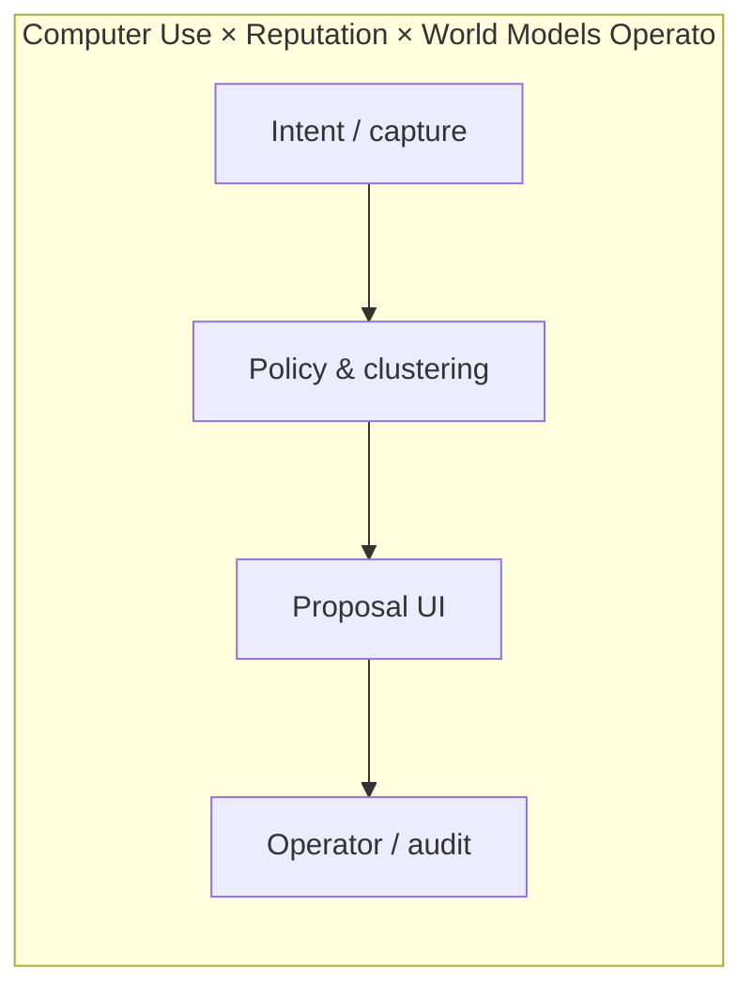

# Computer Use × Reputation × World Models Operator

  

> Invent the category that sits at Computer Use + Reputation + World Models.

**Repository:** [https://github.com/AIFrontiersLab/ComputerUse](https://github.com/AIFrontiersLab/ComputerUse)

---

## Why this exists

A three-way collision: Computer Use, Reputation, and World Models.

**Why now:** These technologies started showing up in the same signal clusters this cycle.

**What recently changed:** Signal cluster formed across independent sources.

**Why it was hard before:** At least one of the ingredients was too weak, expensive, or unstandardized.

---

## Product thesis

| | |
|---|---|
| **Future thesis** | These capabilities rarely sat in the same stack until recently. |
| **First customer** | A lab or startup already combining two of the three |
| **Market** | Emerging infrastructure |
| **Convergence** | Computer Use, Reputation, World Models |
| **Moat** | Workflow data at the intersection. |

---

## MVP

A narrow demo that only works if all colliding capabilities are present.

### Core loop

1. Accept an agent (or human-on-behalf-of-agent) intent
2. Enforce scope / policy / evidence
3. Execute the smallest useful autonomous step
4. Leave an audit trail a human can kill-switch

---

## Architecture

```text
Adapters for each capability + a joint orchestration core.
```



---

## Start

```bash
python3 -m http.server 4173 --directory .
```

---

## Why it may win

Category does not yet have an incumbent owner.

## Why it may fail

The collision is interesting but not a job-to-be-done.

### Risks

- One of the technologies remains a toy

### Unknowns

- Which node is actually the bottleneck

### Current alternatives

- Stitching tools together manually

### Assumptions

- Agent workflows will keep expanding into real systems

---

## Scope

This project is intentionally scoped to **AI and Agentic AI** only.

---

## Tags

`ai` `agentic-ai` `autonomous-agents` `vectra-futurelab` `prototype` `computer-use` `reputation` `world-models`
